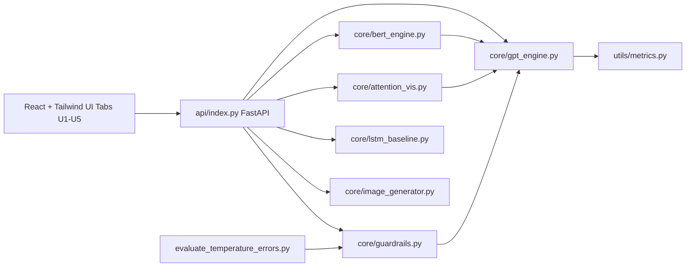

# Next-Token Probability Lab (P5)

An interactive computational laboratory analyzing next-token probability distributions in language models and evaluating how sampling configurations alter generation dynamics. The system implements autoregressive sampling mechanics, multi-head self-attention inspection, recurrent baseline comparison, bidirectional versus causal prediction, from-scratch PyTorch generation loops, and Responsible AI error audits.

Built with a **React + Tailwind CSS** frontend and a **FastAPI** backend designed for deployment on **Vercel**.

## Setup & Local Development

### 1. Install Dependencies

```bash
# Python dependencies
pip install -r requirements.txt

# Node / React dependencies
npm install
```

### 2. Run Locally

Option A: Using Vercel CLI (matches cloud environment):
```bash
vercel dev
```

Option B: Running Frontend and Backend separately:
```bash
# Terminal 1: Start FastAPI backend on port 8000
python -m uvicorn api.index:app --reload --port 8000

# Terminal 2: Start Vite React frontend on port 3000
npm run dev
```

### 3. Deploy to Vercel

```bash
vercel
```
Or import the repository directly on the Vercel Dashboard:
- Framework Preset: **Vite**
- Build Command: `npm run build`
- Output Directory: `dist`
- Environment Variables: `HF_TOKEN` (optional: enables remote Hugging Face Inference API for sd-turbo)

Unit test execution: `pytest -q`.

## System Architecture



## Evaluation: Error versus Temperature

Closed-book benchmark of 24 factual queries evaluated with a 3-shot prompt, pure temperature sampling, and 6 new tokens per completion. An answer is classified as an error when no accepted target entity appears in the initial completion line. Hallucination rate measures the subset of errors that assert an unsupported capitalized entity or numeric expression. Uncertainty intervals represent 95% Wilson score intervals.

Reproduce and update the empirical results table:

```bash
python evaluate_temperature_errors.py --samples 5 --update-readme
```

<!-- RESULTS_START -->
| Temperature | Trials | Factual error rate (95% CI) | Hallucination rate (95% CI) | Mean step entropy (bits) |
|---:|---:|---:|---:|---:|
| 0.2 | 48 | 68.8% (54.7%-80.1%) | 52.1% (38.3%-65.5%) | 0.23 |
| 0.6 | 48 | 81.2% (68.1%-89.8%) | 66.7% (52.5%-78.3%) | 1.02 |
| 1.0 | 48 | 91.7% (80.4%-96.7%) | 79.2% (65.7%-88.3%) | 3.38 |
| 1.2 | 48 | 91.7% (80.4%-96.7%) | 87.5% (75.3%-94.1%) | 5.53 |
| 1.6 | 48 | 100.0% (92.6%-100.0%) | 100.0% (92.6%-100.0%) | 10.88 |
<!-- RESULTS_END -->

## Failure Analysis: High-Temperature Tail-Mass Inflation

**Symptom.** At elevated sampling temperatures ($T = 1.2$) without truncation, completions drift away from target entities (for example, generating unrelated geographical names following `"What is the capital of Australia? A:"`), causing an increase in hallucination rate relative to low-temperature regimes ($T = 0.2$). Empirical failure cases are catalogued in `results/failure_cases.json`.

**Mathematical Formulation.** Next-token sampling draws indices from the temperature-scaled categorical distribution:

$$p_i(T) = \frac{\exp(z_i / T)}{\sum_{j=1}^{V} \exp(z_j / T)}$$

where $z_i$ represents the unnormalized logit for vocabulary token $i$, and $V$ is vocabulary size ($V = 50{,}257$ for GPT-2). 

When $T > 1$, the reciprocal scaling factor $1/T < 1$ compresses pairwise logit margins $\Delta z = z_i - z_j$:

$$\frac{\partial p_i}{\partial z_i} \propto \frac{1}{T}$$

This flattening shifts probability mass away from prominent modes toward tens of thousands of low-probability tail tokens. Because the vocabulary cardinality is large, aggregated tail mass can exceed modal likelihood:

$$\sum_{i \in \text{tail}} p_i(T) > p_{\text{mode}}(T)$$

**Worked Synthetic Distribution.** Consider two candidate head tokens with raw probabilities $p(\text{correct}) = 0.60$ and $p(\text{distractor}) = 0.25$, with a residual tail of $50{,}000$ tokens uniformly sharing $0.15$:

| Temperature $T$ | $p(\text{correct})$ | $p(\text{distractor})$ | Aggregate Tail Mass |
|---:|---:|---:|---:|
| 0.2 | 0.988 | 0.012 | 0.000 |
| 1.0 | 0.600 | 0.250 | 0.150 |
| 1.2 | 0.295 | 0.142 | 0.563 |

At $T = 1.2$, $p(\text{correct})$ drops from $0.600$ to $0.295$, while low-probability tail tokens absorb $56.3\%$ of the total distribution mass. At $T = 0.2$, the distribution becomes near-deterministic ($p = 0.988$).

**Mitigation.** Top-$k$ filtering ($k = 50$) truncates the distribution to the highest 50 logits prior to renormalization, eliminating the long tail and restoring $p(\text{correct}) \approx 0.67$. Top-$p$ nucleus filtering dynamically thresholds the smallest set of tokens whose cumulative mass satisfies $\sum_{i \in S} p_i \ge p$.

## Responsible AI

Model architecture details, dataset lineage, and bias evaluations are documented in [MODEL_CARD.md](MODEL_CARD.md). The application provides real-time logit suppression for safety filtering, calibration curve visualization, and interactive cloze hallucination benchmarking.
